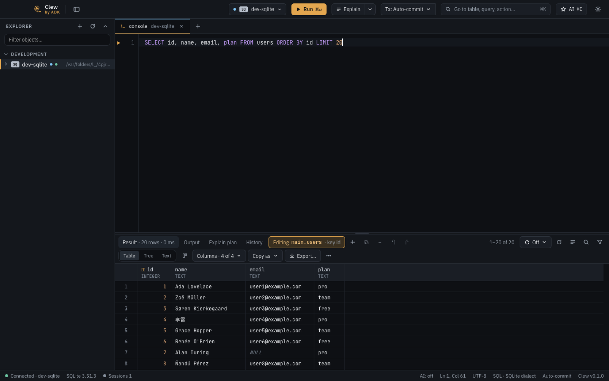
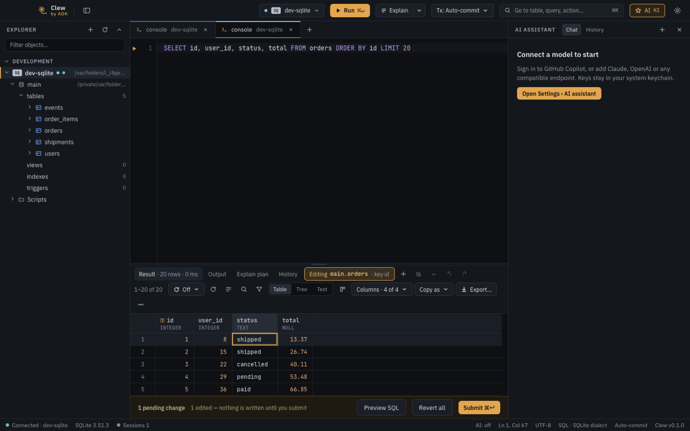
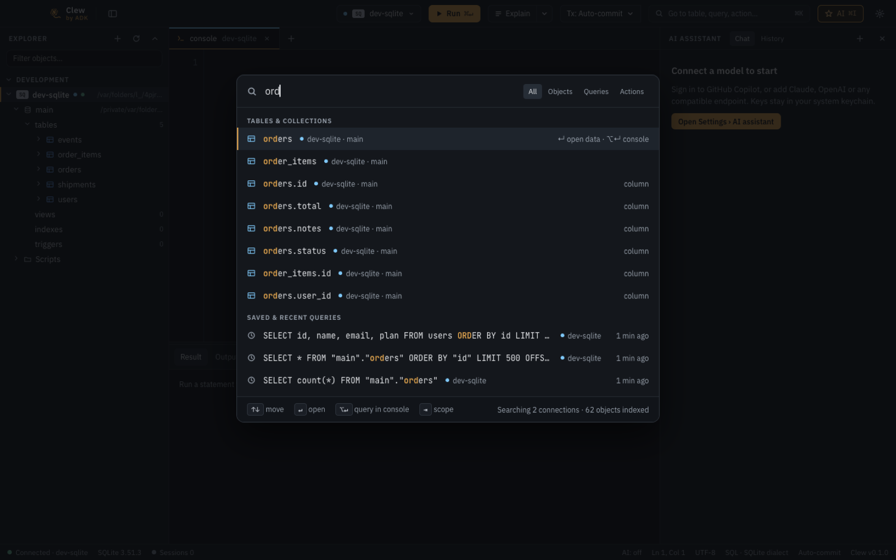
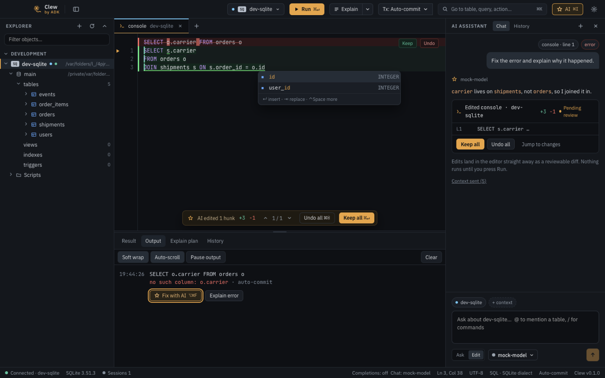
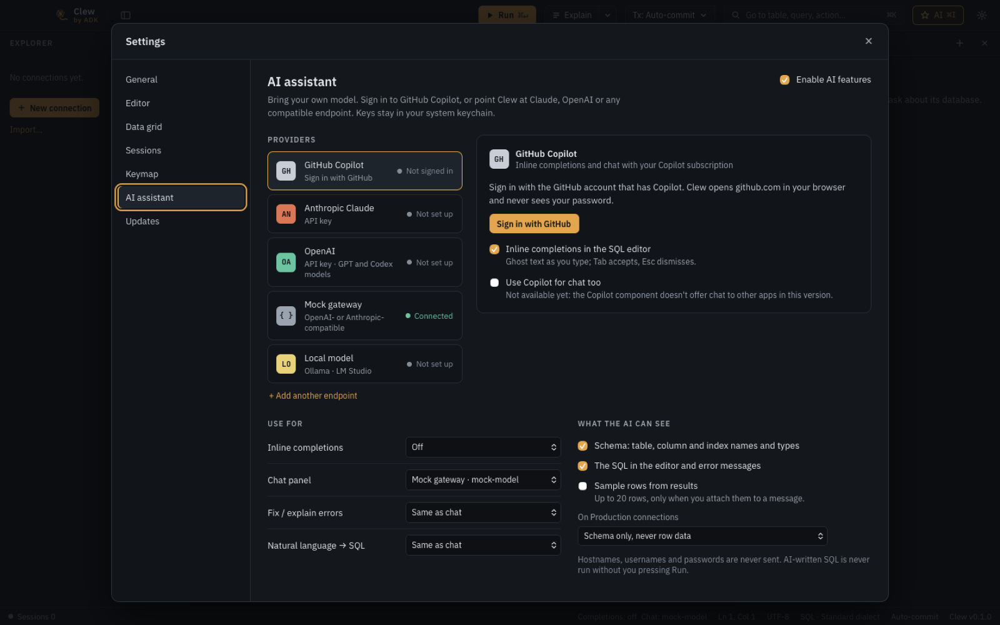

# Clew

*by ADK*

**Clew** (an old English word for a ball of thread used to guide someone out of a labyrinth) is an open-source database IDE in the spirit of JetBrains DataGrip, for macOS and Windows.



- **SQL:** PostgreSQL, MySQL, MariaDB, SQLite, SQL Server, Oracle, ClickHouse, DuckDB
- **NoSQL:** MongoDB, Redis, Neo4j (graph view and Cypher console)
- **Connections:** saved connections with environments (local, dev, staging, production), SSH tunnels, TLS, secrets in the system keychain, encrypted export and import (also from DataGrip, DBeaver and pgpass)
- **SQL console:** schema-aware completion, run a statement or a script, history, editable results, transactions and a Sessions panel
- **Data grid:** virtualized results, staged edits submitted in one transaction, record panel with foreign-key navigation, export
- **Go to anything:** `⌘K` / `Ctrl+K` searches every table, column, query and action across all connections
- **Production safeguards:** read-only by default, confirmed writes, blocked dangerous statements
- **AI assistant, bring your own model:** GitHub Copilot, Claude, OpenAI, any compatible endpoint, or a local model. Edits land in the editor as a diff you review; the AI never runs SQL

| | |
| --- | --- |
|  |  |
|  |  |

## Install

Download the installer for your system from the [latest release](https://github.com/karthikkumararun/clew/releases/latest):

| System | File |
| --- | --- |
| macOS 12 or later (Apple Silicon and Intel) | `Clew_<version>_universal.dmg` |
| Windows 10 / 11 (x64) | `Clew_<version>_x64.exe` (or `.msi`) |

Checksums are in `SHA256SUMS.txt` on the release page.

### Unsigned builds

Releases are signed and notarized only when the maintainer has signing certificates; the release page says when a build is **unsigned**. Then:

- **macOS** will refuse to open it at first. Drag Clew to Applications, then right-click it and choose **Open**, or run once:
  ```sh
  xattr -dr com.apple.quarantine /Applications/Clew.app
  ```
- **Windows** SmartScreen shows a warning. Choose **More info**, then **Run anyway**.

Clew installs per user on Windows and needs no administrator rights.

### Updates

Clew makes **no network requests on its own**. Turn on *Settings › Updates › Check for updates automatically* (or press *Check now*) and it looks for a newer release on GitHub. Update packages are signed and verified before they are installed, and Clew asks before restarting and never discards unsaved work.

## Build from source

You need Node 20+ (22 in CI), [pnpm](https://pnpm.io), a stable Rust toolchain and the [Tauri 2 prerequisites](https://v2.tauri.app/start/prerequisites/).

```sh
pnpm install
pnpm tauri dev      # run the app
pnpm tauri build    # build an installer for this platform (unsigned)
```

See [CONTRIBUTING.md](CONTRIBUTING.md) for tests, the OpenSpec workflow and pull requests, and [docs/releasing.md](docs/releasing.md) for how releases are made.

## Databases

| | Driver | Notes |
| --- | --- | --- |
| PostgreSQL, MySQL, MariaDB, SQLite, ClickHouse, DuckDB, SQL Server | built in | SQL Server and PostgreSQL support TLS and SSH tunnels |
| Oracle | needs the [Oracle Instant Client](https://www.oracle.com/database/technologies/instant-client.html) | Clew explains what is missing and finds it once installed |
| MongoDB, Redis, Neo4j | built in | documents, keys, and a graph view with Cypher |

## AI and privacy

The assistant is off until you set up a provider in *Settings › AI assistant*, and it talks only to the endpoint you configure.

- **Keys** live in the system keychain, never in files or logs.
- **What the AI can see** is yours to choose: the schema, the SQL in the editor and error messages (on by default), and sample result rows you attach yourself (off by default, at most 20). Hostnames, usernames and passwords are never sent.
- **Production connections** send the schema only, or switch the AI off entirely, as you choose. Every reply lists the context that was sent with it.
- **The AI never runs SQL.** In Edit mode it writes into the console as a pending diff; nothing runs until you press Run.
- **GitHub Copilot** uses GitHub's own language server, downloaded only after you agree, and signs in with GitHub's device flow, so Clew never sees your password.
- There is no telemetry.

## Project layout

| Path | What |
| --- | --- |
| `src/` | React + TypeScript front end |
| `src-tauri/` | Rust back end (drivers, connections, AI, updater) |
| `design/` | The UX: tokens, visual language, screen sources |
| `openspec/` | Specs and change proposals (OpenSpec) |
| `e2e/`, `docs/qa/` | End-to-end journeys and the release quality loop |
| `CLAUDE.md` | Build order and rules for coding agents |

## Contributing and security

Contributions are welcome: see [CONTRIBUTING.md](CONTRIBUTING.md) and the [Code of Conduct](CODE_OF_CONDUCT.md). Report vulnerabilities privately as described in [SECURITY.md](SECURITY.md).

## License

[MIT](LICENSE) © ADK. Third-party licenses are listed in the app under *About › Third-party licenses*.
